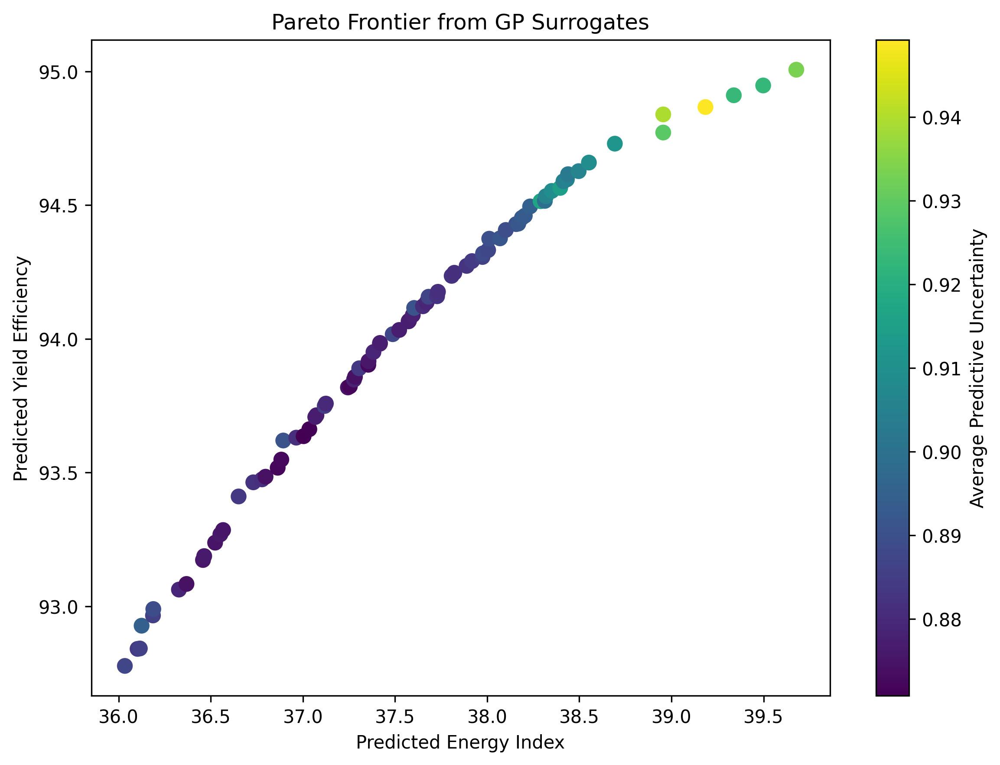
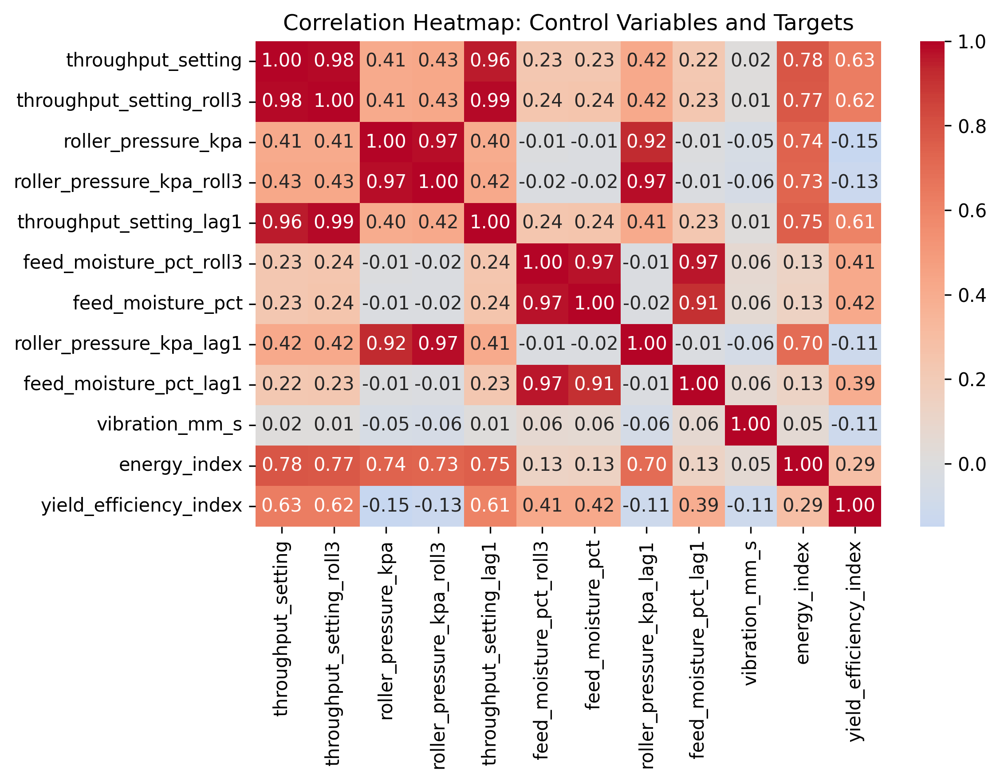
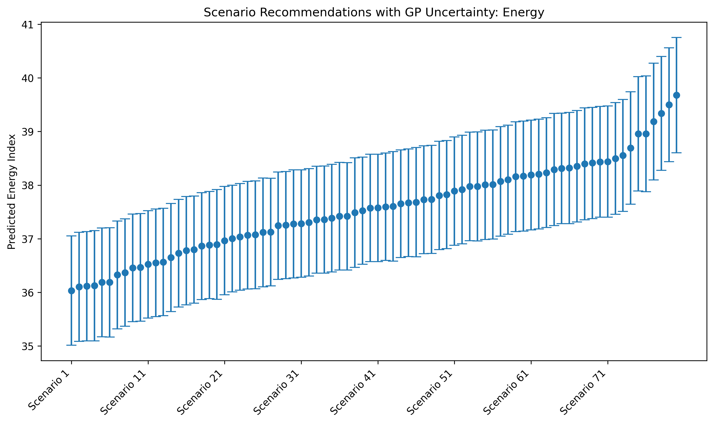
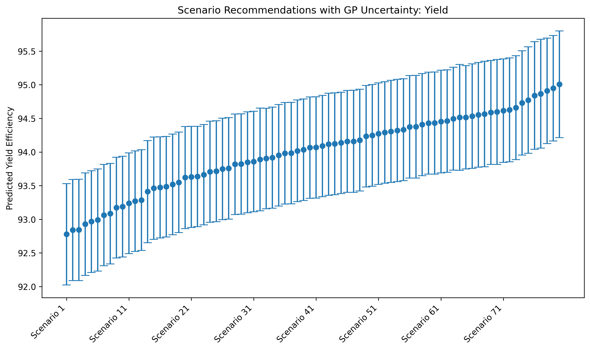

# UPMO: Uncertainty-Aware Multi-Objective Optimization for Smart Agriculture

<!-- TODO: replace with the exact paper title and venue badge once confirmed -->
[](docs/ACIT_2026_Paper_307.pdf)
[](requirements.txt)
[](LICENSE)

Official code, data and results for the ACIT'2026 paper **"[PAPER TITLE]"** (Paper #307).

| 📄 [Paper](docs/ACIT_2026_Paper_307.pdf) | 🎤 [Slides](docs/Presentation_Slides.pdf) | 🏅 [Certificate](docs/Certificate_of_Attendance.pdf) | 📓 [Notebook](notebooks/acit_conference_workflow.ipynb) |
|---|---|---|---|

---

## Overview

Agricultural processing lines must trade **energy consumption** against **yield efficiency**.
The two goals usually conflict, and the sensor data behind any data-driven recommendation is
noisy. This project proposes a decision-support pipeline that:

1. learns **Gaussian Process (GP) surrogate models** of energy and yield from IoT sensor
   time series,
2. searches the controllable operating settings with a **Pareto-based multi-objective
   evolutionary algorithm** (NSGA-II style), and
3. reports every recommended setting **together with its predictive uncertainty**, so
   operators can choose between Conservative, Balanced and Aggressive operating profiles
   knowing how reliable each prediction is.

## Pipeline


| Stage | Module | Method |
|---|---|---|
| Preprocessing | [`src/preprocessing.py`](src/preprocessing.py) | KNN imputation (k=5), lag-1 and 3-step rolling-mean features |
| Feature selection | [`src/feature_selection.py`](src/feature_selection.py) | Mean Random Forest importance across both targets → top-10 control variables |
| Surrogates | [`src/surrogate_models.py`](src/surrogate_models.py) | `GaussianProcessRegressor` with `C · RBF(ARD) + WhiteKernel`, benchmarked against LR, RF and GBR on a **chronological 80/20 split** |
| Optimization | [`src/optimization.py`](src/optimization.py) | Elitist Pareto-dominance GA (pop 80, 50 generations, blend crossover, Gaussian mutation); optional uncertainty-penalized fitness `μ ± β·σ`; hypervolume and spacing metrics |
| Decision support | [`src/decision_support.py`](src/decision_support.py) | Scenario profiling from the front (min-energy, knee point, max-yield) with ±1σ GP error bars |

## Results

All results come from the synthetic dataset in [`data/`](data/README.md) (1,200 hourly records).

### Surrogate accuracy (chronological split, last 20% held out)

| Model | Energy MAE ↓ | Energy RMSE ↓ | Energy R² ↑ | Yield MAE ↓ | Yield RMSE ↓ | Yield R² ↑ |
|---|---|---|---|---|---|---|
| Linear Regression | 0.803 | 1.011 | 0.504 | **0.588** | **0.728** | **0.714** |
| Random Forest | 0.906 | 1.137 | 0.371 | 0.885 | 1.083 | 0.366 |
| Gradient Boosting | 0.870 | 1.090 | 0.423 | 0.738 | 0.914 | 0.548 |
| **Gaussian Process** | **0.762** | **1.001** | **0.513** | 0.629 | 0.781 | 0.671 |

The GP is the most accurate energy model and second-best for yield. Unlike the baselines, it
also gives a calibrated predictive standard deviation, which the optimizer and the decision
layer rely on.

### Pareto front

| Hypervolume | Spacing | Non-dominated solutions |
|---|---|---|
| 11.77 | 0.038 | 80 |

<p align="center">
  
  
</p>

### Operating scenarios

| Scenario | Predicted energy (±σ) | Predicted yield (±σ) | Throughput (%) | Roller pressure (kPa) |
|---|---|---|---|---|
| Conservative (min energy) | 36.03 ± 1.02 | 92.78 ± 0.75 | 62.0 | 102.1 |
| Balanced (knee point) | 37.60 ± 1.02 | 94.12 ± 0.76 | 71.3 | 102.1 |
| Aggressive (max yield) | 39.68 ± 1.07 | 95.01 ± 0.79 | 80.9 | 104.0 |

For reference, the historical averages are energy 40.09 and yield 92.37. The Balanced profile
is predicted to lower energy by about 6% while raising yield by about 1.9%. These are surrogate
predictions, not measured plant outcomes.

<p align="center">
  
  
</p>

More figures (actual vs. predicted plots, convergence curves, per-metric model comparisons)
are in [`results/figures/`](results/figures). Raw numbers are in [`results/metrics/`](results/metrics).

## Repository structure

```
upmo-smart-agriculture/
├── README.md
├── LICENSE
├── requirements.txt
├── run_pipeline.py                     <- one-command end-to-end run
├── data/
│   ├── raw/synthetic_agritech_sensor_dataset.csv
│   └── README.md                       <- data schema and variable dictionary
├── src/
│   ├── preprocessing.py
│   ├── feature_selection.py
│   ├── surrogate_models.py
│   ├── optimization.py
│   └── decision_support.py
├── notebooks/
│   └── acit_conference_workflow.ipynb  <- step-by-step interactive walkthrough
├── docs/
│   ├── ACIT_2026_Paper_307.pdf
│   ├── Presentation_Slides.pdf
│   └── Certificate_of_Attendance.pdf
└── results/                            <- published figures and metrics
    ├── figures/
    └── metrics/
```

## Getting started

```bash
git clone https://github.com/naimabouk/upmo-smart-agriculture.git
cd upmo-smart-agriculture
pip install -r requirements.txt

python run_pipeline.py                  # full pipeline, about 5 min on a laptop CPU
python run_pipeline.py --beta 0.2       # uncertainty-penalized (risk-averse) optimization
python run_pipeline.py --help           # all options
```

Outputs go to `results_reproduced/`. You can also open the notebook in Jupyter or Colab.

**Reproducibility note:** all random seeds are fixed (42). With current scikit-learn releases
the surrogate metrics match the published ones to within 1e-5. The evolutionary search is
sensitive to those tiny numerical differences, so a re-run gives a slightly different (but
equivalent) Pareto front. The paper's exact outputs are kept in `results/`.

## Citation

<!-- TODO: complete once the proceedings details are confirmed -->
```bibtex
@inproceedings{boukhiar2026upmo,
  title     = {An Uncertainty-Aware Predictive
Multi-Objective Optimization Framework for Smart
Agriculture},
  author    = {Boukhiar Naima and Sam },
  booktitle = {Proceedings of the International Conference on Information Technology (ACIT'2026)},
  year      = {2026},
  note      = {Paper \#307}
}
```

## Contact

**Naima Boukhiar**, LMCS Laboratory, École nationale Supérieure d'Informatique (ESI), Algiers
✉️ naima.boukhiar@univ-alger.dz

## License

Released under the [MIT License](LICENSE).
